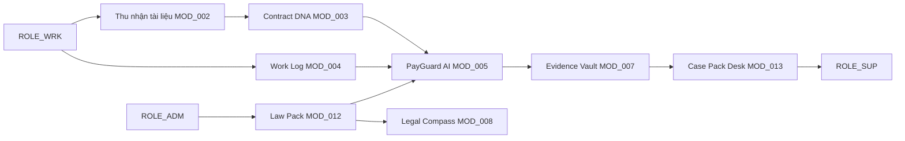

# 01. TỔNG QUAN HỆ THỐNG

## 1. Mục đích

Hành Trang – Waypoint AI là ứng dụng và nền tảng web giúp người lao động di cư (giai đoạn đầu: Việt Nam → Nhật Bản) đối chiếu hợp đồng, giờ làm, phiếu lương và số tiền thực nhận với pháp luật nước làm việc; giữ bằng chứng mang theo được; và nhờ hỗ trợ khi cần. Tài liệu này đặc tả nghiệp vụ và hệ thống ở mức đủ để thiết kế và lập trình. Tài liệu không bàn về thị trường, đối thủ, mô hình kinh doanh hay tài chính dự án.

## 2. Nguyên tắc thiết kế `[ĐÃ XÁC NHẬN]`

1. Lõi miễn phí vận hành được mà không phụ thuộc dịch vụ bên thứ ba (OCR và mô hình ngôn ngữ có phương án tự host; Law Pack nằm trên thiết bị).
2. AI không tính tiền: mọi con số do bộ tính cố định dựa trên Law Pack (BR_007).
3. Mọi hành động đi ra ngoài (chia sẻ, gửi, thanh toán) cần người dùng duyệt; agent chỉ ở mức 0 đến 2 (BR_006, BR_048).
4. Hệ thống không kết luận vi phạm; chỉ có ba nhãn luật Phù hợp, Nên hỏi lại, Chưa có quy tắc (BR_009).
5. Dữ liệu thuộc về người lao động: đồng ý tách riêng theo mục đích, mặc định tắt (BR_037).

## 3. Phạm vi

Trong phạm vi: 17 module, 150 chức năng (FUN_001 đến FUN_150), đặc tả toàn bộ, không giới hạn ở MVP. Ưu tiên P1 ghi ở Feature List để xếp thứ tự triển khai.

| Mã | Module | Số chức năng |
|---|---|---|
| MOD_001 | Tài khoản & truy cập | 18 |
| MOD_002 | Thu nhận tài liệu | 9 |
| MOD_003 | Contract DNA | 6 |
| MOD_004 | Work Log | 7 |
| MOD_005 | PayGuard AI | 10 |
| MOD_006 | Salary Twin | 7 |
| MOD_007 | Evidence Vault | 10 |
| MOD_008 | Legal Compass | 8 |
| MOD_009 | Rights Agent | 9 |
| MOD_010 | Cost Ledger | 6 |
| MOD_011 | Debt & Family | 10 |
| MOD_012 | Law Pack Management | 15 |
| MOD_013 | Case Pack Desk | 17 |
| MOD_014 | Quản trị & vận hành | 8 |
| MOD_015 | Thông báo & nhắc việc | 5 |
| MOD_016 | Gói dịch vụ | 2 |
| MOD_017 | Đóng góp dữ liệu ẩn danh | 3 |

Ngoài phạm vi: phân tích thị trường, đối thủ, mô hình kinh doanh, tài chính dự án; tư vấn pháp lý có tính ràng buộc; tự động gửi thư hoặc nộp đơn thay người dùng.

## 4. Tác nhân

Xem `02_ROLE_PERMISSION.md`. Ba vai trò: ROLE_WRK, ROLE_SUP, ROLE_ADM; trạng thái truy cập ACC_GUEST, ACC_FAMLINK; tác nhân hệ thống SYS_OCR, SYS_AGENT, SYS_SCHED.

## 5. Luồng tổng quát

## 6. Giả định `[GIẢ ĐỊNH]`

- Giai đoạn đầu có một hành lang hoạt động là VN-JP; kiến trúc cho phép thêm hành lang qua Law Pack.
- Người lao động dùng thiết bị di động; web hỗ trợ cùng chức năng.
- Mọi tham số số liệu (ngưỡng, thời hạn, giới hạn) lưu ở SYSTEM_CONFIG và chỉnh được mà không cần phát hành lại ứng dụng.

## 7. Nhãn tin cậy

Mọi mục trong bộ tài liệu mang một trong các nhãn: `[ĐÃ XÁC NHẬN]` (đã được người phụ trách xác nhận), `[ĐỀ XUẤT]` (đề xuất của người đặc tả), `[GIẢ ĐỊNH]`, `[CẦN XÁC NHẬN]`. Danh mục chức năng FUN_001 đến FUN_145 và các vai trò đã được xác nhận; FUN_146 đến FUN_150, mô hình trường dữ liệu và các tham số là `[ĐỀ XUẤT]` trừ khi ghi khác.

## 8. Danh mục điểm cần xác nhận `[CẦN XÁC NHẬN]`

1. Loại định danh đăng nhập (email hay số điện thoại) và cơ chế khôi phục tài khoản (FUN_001, FUN_004)
2. Tham số khóa đăng nhập sai: 5 lần, 15 phút (BR_036)
3. Giới hạn kích thước tệp tải lên, đề xuất 10 MB (BR_040)
4. Thời hạn tối đa của chia sẻ Case Pack, đề xuất 30 ngày và liên kết người thân, đề xuất 90 ngày (FUN_116, FUN_093)
5. Dung sai làm tròn khi đối chiếu (BR_051)
6. Xử lý bản sao trên máy chủ khi xóa nhanh (BR_034)
7. Thời hạn duyệt và hoàn tác hành động của agent: 48 giờ, 24 giờ (BR_047)
8. Ngưỡng k-ẩn danh, đề xuất k = 20 (BR_043)
9. Danh sách loại tổ chức hỗ trợ (SUPPORT_ORG.org_type)
10. Thông số gói Free/Pro (PLAN)
11. Văn bản hợp nhất về trần phí tại Việt Nam cần kiểm chứng trước khi phát hành (BR_030)
12. Chính sách lưu trữ: số ngày lưu theo từng nhóm dữ liệu (RETENTION_POLICY)

## 9. Thuật ngữ

| Thuật ngữ | Nghĩa |
|---|---|
| Law Pack | Bộ quy tắc luật có nguồn, điều khoản, ngày hiệu lực, được duyệt và phát hành theo phiên bản |
| Hành lang | Cặp nước gửi - nước làm việc, ví dụ VN-JP |
| Case Pack | Hồ sơ song ngữ người lao động soạn từ bằng chứng để nhờ hỗ trợ |
| Khớp / Lệch / Chưa đủ | Ba trạng thái của một dòng đối chiếu (BR_008) |
| Phụ trội | Phần trả thêm cho giờ làm thêm, làm đêm, ngày nghỉ luật định |
| OCR kép | Hai lượt đọc ký tự độc lập để so khớp |
| Agent | Thành phần AI chuyên biệt làm việc theo nhiệm vụ, có giới hạn tự chủ |
