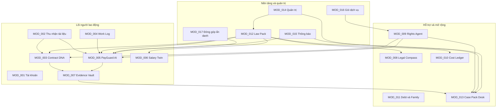

# 03. KIẾN TRÚC CHỨC NĂNG

## 1. Bản đồ module

## 2. Chi tiết module

| Mã | Module | Mục tiêu | Số FUN | Dải FUN | Entity chính |
|---|---|---|---|---|---|
| MOD_001 | Tài khoản & truy cập | Đăng ký, đăng nhập, riêng tư, đồng ý, đồng bộ mã hóa | 18 | FUN_001–FUN_145 | USER, USER_PROFILE, PRIVACY_SETTING, CONSENT, DEVICE_SESSION, SYNC_BACKUP |
| MOD_002 | Thu nhận tài liệu | Chụp, tải, đọc OCR kép, xác nhận trường | 9 | FUN_016–FUN_024 | DOCUMENT, EXTRACTED_FIELD |
| MOD_003 | Contract DNA | Phân rã, dịch, gắn nhãn luật, điểm cần hỏi | 6 | FUN_025–FUN_030 | CONTRACT_CLAUSE, CONTRACT_QUESTION |
| MOD_004 | Work Log | Ghi giờ nhanh, giọng nói, khóa kỳ | 7 | FUN_031–FUN_146 | WORK_LOG |
| MOD_005 | PayGuard AI | Đối chiếu bốn nguồn với Law Pack | 10 | FUN_037–FUN_046 | PAY_PERIOD, RECON_LINE |
| MOD_006 | Salary Twin | Mô phỏng thu nhập, so sánh lời đề nghị | 7 | FUN_047–FUN_053 | SCENARIO, JOB_OFFER |
| MOD_007 | Evidence Vault | Kho bằng chứng toàn vẹn, Passport | 10 | FUN_054–FUN_063 | EVIDENCE_ITEM, EVIDENCE_HISTORY |
| MOD_008 | Legal Compass | Hỏi đáp có trích dẫn, tra cứu luật | 8 | FUN_064–FUN_071 | LAW_QA |
| MOD_009 | Rights Agent | Agent theo nhiệm vụ, phê duyệt, hoàn tác | 9 | FUN_072–FUN_080 | AGENT_TASK, AGENT_ACTION, AGENT_SETTING |
| MOD_010 | Cost Ledger | Chi phí đi làm, kiểm tra trần phí | 6 | FUN_081–FUN_086 | COST_ITEM |
| MOD_011 | Debt & Family | Nợ, kế hoạch trả, liên kết người thân | 10 | FUN_087–FUN_096 | DEBT, DEBT_PAYMENT, DEBT_PLAN, FAMILY_LINK |
| MOD_012 | Law Pack Management | Soạn, duyệt, phát hành, khôi phục luật | 15 | FUN_097–FUN_150 | LAW_RULE, LAW_RULE_TEST, LAW_PACK_VERSION, LAW_SOURCE, CORRIDOR, LAW_UPDATE_PROPOSAL |
| MOD_013 | Case Pack Desk | Case Pack, chia sẻ, Desk của cán bộ | 17 | FUN_111–FUN_149 | CASE_PACK, CASE_PACK_ITEM, CASE_SHARE, ACCESS_LOG, DESK_CASE, CASE_NOTE, INFO_REQUEST, LETTER_DRAFT |
| MOD_014 | Quản trị & vận hành | Tổ chức, Quản trị viên, nhật ký, cấu hình | 8 | FUN_125–FUN_132 | SUPPORT_ORG, ORG_MEMBER, AUDIT_LOG, PROVIDER_CONFIG, SYSTEM_CONFIG, RETENTION_POLICY |
| MOD_015 | Thông báo & nhắc việc | Nhắc việc, thông báo, báo luật đổi | 5 | FUN_133–FUN_137 | NOTIFICATION, REMINDER_SETTING |
| MOD_016 | Gói dịch vụ | Gói Free/Pro, hạn mức | 2 | FUN_138–FUN_139 | PLAN, SUBSCRIPTION, USAGE_COUNTER |
| MOD_017 | Đóng góp dữ liệu ẩn danh | Đóng góp ẩn danh, thống kê k-ẩn danh | 3 | FUN_140–FUN_142 | ANON_CONTRIBUTION, AGG_STAT |

## 3. Thành phần logic dùng chung `[ĐỀ XUẤT]`

| Thành phần | Vai trò | Ràng buộc |
|---|---|---|
| Bộ tính toán cố định (Calc Engine) | Tính giờ, phụ trội, mức tối thiểu, trần phí, lịch trả nợ từ Law Pack | Không dùng mô hình ngôn ngữ (BR_007) |
| Law Pack Runtime | Nạp phiên bản đã phát hành, chọn quy tắc theo ngày hiệu lực | BR_010, BR_026 |
| OCR Service | Đọc ký tự hai lượt, trả độ tin cậy | Có phương án tự host (FUN_129) |
| LLM Gateway | Dịch, diễn giải, soạn nháp; trừu tượng hóa nhà cung cấp, có mô hình mở dự phòng | Chỉ dùng khi được đồng ý (BR_038), hết hạn mức thì dùng mẫu (BR_039) |
| Orchestrator và agent | Phân rã nhiệm vụ, giao cho sáu agent chuyên biệt, Kiểm chứng kết quả | Mức tự chủ ≤ 2 (BR_006) |
| Kho tài liệu mã hóa | Lưu tệp mã hóa theo người dùng, mã băm toàn vẹn | BR_016 |
| Notification Service | Đẩy thông báo, giờ yên lặng, chế độ kín đáo | BR_041, BR_033 |
| Audit Service | Ghi nhật ký bất biến | BR_004 |

Sáu agent chuyên biệt (SYS_AGENT): Hợp đồng, Chi phí đi làm, Đối chiếu lương, Bằng chứng và Hồ sơ, Canh luật, Hỗ trợ/Nợ/Gia đình; cộng Orchestrator và Kiểm chứng.

## 4. Phụ thuộc giữa chức năng chính

| Chức năng | Phụ thuộc |
|---|---|
| FUN_039 Chạy đối chiếu | FUN_019 xác nhận trường, FUN_031 ghi giờ, FUN_037 tạo kỳ, FUN_038 số tiền nhận, FUN_106 Law Pack đã phát hành |
| FUN_116 Chia sẻ Case Pack | FUN_010 đồng ý CASE_SHARE, FUN_111 đến FUN_114 soạn và xem trước, FUN_125 tổ chức nhận |
| FUN_106 Phát hành Law Pack | FUN_099 đến FUN_105 soạn, kiểm thử, duyệt |
| FUN_064 Hỏi đáp luật | FUN_106 Law Pack, FUN_071 đồng bộ về thiết bị |
