# 07. QUY TẮC NGHIỆP VỤ VÀ LUỒNG NGHIỆP VỤ

## 1. Quy tắc nghiệp vụ (BR)

Nhãn: ĐÃ XÁC NHẬN / ĐỀ XUẤT / CẦN XÁC NHẬN. Cột Chức năng liệt kê chức năng áp dụng quy tắc.

| Mã | Tên | Nội dung | Nhãn | Chức năng áp dụng |
|---|---|---|---|---|
| BR_001 | Tách ba vai trò khi phát hành luật | Người soạn, người duyệt và người phát hành một quy tắc hoặc một phiên bản Law Pack phải là ba tài khoản Quản trị viên khác nhau. | [ĐỀ XUẤT] | FUN_104, FUN_106, FUN_107 |
| BR_002 | Tối thiểu hai Quản trị viên | Hệ thống luôn có ít nhất 2 Quản trị viên đang hoạt động; không được thu hồi hoặc khóa Quản trị viên cuối cùng. | [ĐỀ XUẤT] | FUN_127 |
| BR_003 | Không tự cấp, tự thu hồi quyền | Quản trị viên không được tự tạo hoặc tự thu hồi quyền của chính mình. | [ĐỀ XUẤT] | FUN_127 |
| BR_004 | Nhật ký kiểm toán bất biến | Mọi thao tác quản trị được ghi vào AUDIT_LOG; Quản trị viên không có chức năng sửa hoặc xóa nhật ký. | [ĐỀ XUẤT] | FUN_097, FUN_098, FUN_099, FUN_104, FUN_105, FUN_106, FUN_107, FUN_109, FUN_125, FUN_126, FUN_127, FUN_128 ... |
| BR_005 | Quản trị viên không đọc nội dung người dùng | Quản trị viên không được đọc tài liệu, kết quả đối chiếu, bằng chứng hoặc Case Pack của người dùng; chỉ thấy siêu dữ liệu và số liệu tổng hợp. | [ĐÃ XÁC NHẬN] | FUN_066, FUN_124, FUN_128, FUN_132 |
| BR_006 | Giới hạn mức tự chủ của agent | Agent hoạt động ở mức 0 đến 2 (đọc, gợi ý, soạn nháp, thao tác nhỏ hoàn tác được). Mọi hành động đi ra ngoài cần người dùng duyệt. | [ĐÃ XÁC NHẬN] | FUN_072, FUN_075, FUN_076, FUN_078, FUN_079, FUN_110 |
| BR_007 | AI không tính tiền | Mọi con số tiền, giờ, phụ trội và mức tối thiểu do bộ tính toán cố định dựa trên Law Pack tính; mô hình ngôn ngữ chỉ diễn giải kết quả. | [ĐÃ XÁC NHẬN] | FUN_027, FUN_039, FUN_042, FUN_043, FUN_045, FUN_048, FUN_049, FUN_052, FUN_053, FUN_064, FUN_074, FUN_085 ... |
| BR_008 | Ba trạng thái đối chiếu | Mỗi dòng đối chiếu chỉ có một trong ba trạng thái: Khớp, Lệch, Chưa đủ dữ liệu. | [ĐÃ XÁC NHẬN] | FUN_039, FUN_040 |
| BR_009 | Ba nhãn luật | Nhãn luật chỉ gồm: Phù hợp (COMPLIANT), Nên hỏi lại (ASK_AGAIN), Chưa có quy tắc (NO_RULE). Hệ thống không kết luận vi phạm. | [ĐÃ XÁC NHẬN] | FUN_026, FUN_027, FUN_039, FUN_085 |
| BR_010 | Chọn quy tắc theo ngày hiệu lực | Khi tính, chọn quy tắc có effective_from ≤ ngày áp dụng và (effective_to rỗng hoặc ≥ ngày áp dụng), thuộc phiên bản Law Pack đã phát hành mới nhất. | [ĐÃ XÁC NHẬN] | FUN_027, FUN_039, FUN_045, FUN_048, FUN_068, FUN_069, FUN_071 |
| BR_011 | Mức phụ trội Nhật Bản | Làm thêm ≥ 25%; ngày nghỉ luật định ≥ 35%; làm đêm 22:00-05:00 ≥ 25%; làm thêm cộng đêm ≥ 50%; ngày nghỉ luật định cộng đêm ≥ 60%; làm thêm trên 60 giờ mỗi tháng ≥ 50%. Giá trị lấy từ Law Pack, không mã hóa cứng. | [ĐÃ XÁC NHẬN] | FUN_039, FUN_048, FUN_049 |
| BR_012 | Lương tối thiểu theo tỉnh | Mức lương giờ tối thiểu lấy theo tỉnh nơi làm việc và ngày hiệu lực từ Law Pack. | [ĐÃ XÁC NHẬN] | FUN_006, FUN_039, FUN_048, FUN_052, FUN_069 |
| BR_013 | Người dùng xác nhận trường tiền và giờ | Trường trích xuất liên quan tiền hoặc giờ chỉ được dùng để tính sau khi người dùng xác nhận hoặc sửa. | [ĐÃ XÁC NHẬN] | FUN_017, FUN_019, FUN_020, FUN_032, FUN_036, FUN_037, FUN_038 |
| BR_014 | Tài liệu không đọc được | Khi OCR không đọc được hoặc độ tin cậy dưới ngưỡng, hệ thống chuyển sang nhập tay và không tự điền giá trị. | [ĐÃ XÁC NHẬN] | FUN_017, FUN_020, FUN_036 |
| BR_015 | Khóa kỳ giờ làm | Mục giờ làm của kỳ đã đối chiếu bị khóa; chỉ sửa được sau khi mở khóa (FUN_146), có ghi nhật ký và đối chiếu lại. | [ĐỀ XUẤT] | FUN_031, FUN_032, FUN_033, FUN_034, FUN_146, FUN_039, FUN_045 |
| BR_016 | Phiên bản và mã băm tài liệu | Sửa tài liệu tạo phiên bản mới, giữ phiên bản cũ; mỗi phiên bản có mã băm nội dung. | [ĐÃ XÁC NHẬN] | FUN_016, FUN_022, FUN_023, FUN_054, FUN_057, FUN_059, FUN_060, FUN_062, FUN_115 |
| BR_017 | Quyền sở hữu dữ liệu ở phía máy chủ | Mọi truy vấn dữ liệu người lao động kiểm tra chủ sở hữu ở phía máy chủ, không dựa vào giao diện. | [ĐÃ XÁC NHẬN] | FUN_001, FUN_003, FUN_005, FUN_006, FUN_011, FUN_013, FUN_016, FUN_018, FUN_021, FUN_022, FUN_024, FUN_026 ... |
| BR_018 | Chia sẻ Case Pack có chọn lọc | Chỉ chia sẻ các phần người dùng chọn, cho một tổ chức nhận, với thời hạn hết hạn bắt buộc. | [ĐÃ XÁC NHẬN] | FUN_112, FUN_116, FUN_149 |
| BR_019 | Thu hồi chia sẻ có hiệu lực ngay | Thu hồi hoặc hết hạn chia sẻ làm cán bộ mất quyền xem ngay lập tức. | [ĐÃ XÁC NHẬN] | FUN_012, FUN_024, FUN_061, FUN_116, FUN_117, FUN_120 |
| BR_020 | Ghi nhật ký truy cập | Mỗi lượt cán bộ xem hoặc thao tác trên Case Pack được ghi vào ACCESS_LOG và người dùng xem được. | [ĐÃ XÁC NHẬN] | FUN_118, FUN_120, FUN_121, FUN_122, FUN_123, FUN_148 |
| BR_021 | Phạm vi dữ liệu của cán bộ | Cán bộ chỉ thấy Case Pack được chia sẻ cho tổ chức của mình, còn hạn, đúng các phần được chia sẻ. | [ĐÃ XÁC NHẬN] | FUN_118, FUN_119, FUN_120, FUN_121, FUN_147 |
| BR_022 | Đóng case | Đóng case cần lý do; case đã đóng không nhận thao tác mới ngoài xem. | [ĐỀ XUẤT] | FUN_123 |
| BR_023 | Đề nghị bổ sung thông tin | Cán bộ gửi đề nghị qua ứng dụng; người dùng toàn quyền trả lời, từ chối hoặc bỏ qua; chưa trả lời thì không có dữ liệu mới. | [ĐỀ XUẤT] | FUN_122, FUN_149 |
| BR_024 | Quy trình duyệt quy tắc luật | Quy tắc đi qua DRAFT → SUBMITTED → APPROVED → RELEASED; trả lại cần ý kiến duyệt. | [ĐÃ XÁC NHẬN] | FUN_099, FUN_100, FUN_103, FUN_104, FUN_105, FUN_106, FUN_109 |
| BR_025 | Điều kiện nộp duyệt quy tắc | Quy tắc phải có nguồn, điều khoản gốc, ngày hiệu lực và toàn bộ ca kiểm thử đạt thì mới nộp duyệt. | [ĐÃ XÁC NHẬN] | FUN_098, FUN_099, FUN_101, FUN_102, FUN_103 |
| BR_026 | Phiên bản phát hành bất biến | Phiên bản Law Pack đã phát hành không sửa; khôi phục bằng cách phát hành phiên bản mới trỏ về nội dung cũ. | [ĐÃ XÁC NHẬN] | FUN_070, FUN_071, FUN_100, FUN_106, FUN_107, FUN_150 |
| BR_027 | Đề xuất từ Canh luật không tự áp dụng | Đề xuất cập nhật luật do agent phát hiện chỉ có hiệu lực sau khi Quản trị viên xử lý theo quy trình BR_024. | [ĐÃ XÁC NHẬN] | FUN_108, FUN_109, FUN_110 |
| BR_028 | Hỏi đáp luật chỉ dựa trích dẫn | Câu trả lời phải dẫn quy tắc, điều khoản và nguồn trong Law Pack; không có quy tắc phù hợp thì từ chối trả lời và nói rõ. | [ĐÃ XÁC NHẬN] | FUN_042, FUN_064, FUN_065 |
| BR_029 | Ngưỡng từ chối | Khi độ tin cậy thấp hơn ngưỡng cấu hình, hệ thống nêu rõ không chắc chắn thay vì trả lời. | [ĐÃ XÁC NHẬN] | FUN_064, FUN_130 |
| BR_030 | Trần phí tại Việt Nam | Phí dịch vụ không vượt 1 tháng lương theo hợp đồng cho mỗi 12 tháng và tổng không vượt 3 tháng lương; không thu phí môi giới từ người lao động (Luật 69/2020/QH14). Kết quả: UNCHECKED, WITHIN_CAP, OVER_CAP, PROHIBITED, NO_RULE. Văn bản hợp nhất cần kiểm chứng trước khi phát hành. | [CẦN XÁC NHẬN] | FUN_081, FUN_082, FUN_085 |
| BR_031 | Kế hoạch trả nợ xác định | Lịch trả nợ tính bằng công thức cố định theo gốc, lãi suất và số tiền trả; không dùng mô hình ngôn ngữ. | [ĐÃ XÁC NHẬN] | FUN_088, FUN_089, FUN_090, FUN_091, FUN_092 |
| BR_032 | Liên kết người thân | Mã liên kết ngẫu nhiên ≥ 128 bit, chỉ lưu mã băm, chỉ xem, giới hạn mục, có hạn, thu hồi được. | [ĐÃ XÁC NHẬN] | FUN_093, FUN_094, FUN_095 |
| BR_033 | Chế độ kín đáo | Khi bật, tên và biểu tượng ứng dụng, nội dung thông báo được thay bằng nội dung trung tính. | [ĐÃ XÁC NHẬN] | FUN_007, FUN_008, FUN_015, FUN_134, FUN_136 |
| BR_034 | Xóa nhanh | Thao tác xóa nhanh xóa dữ liệu cục bộ trên thiết bị; xử lý bản sao trên máy chủ cần xác nhận thêm. | [CẦN XÁC NHẬN] | FUN_009 |
| BR_035 | Xóa tài khoản | Xóa tài khoản xóa dữ liệu người dùng và thu hồi mọi chia sẻ; nhật ký kiểm toán giữ theo chính sách lưu trữ. | [ĐỀ XUẤT] | FUN_012, FUN_131 |
| BR_036 | Khóa đăng nhập sai | Sai mật khẩu 5 lần liên tiếp thì khóa tạm 15 phút. | [CẦN XÁC NHẬN] | FUN_002, FUN_004 |
| BR_037 | Đồng ý tách riêng, mặc định tắt | Mỗi mục đích (chia sẻ Case Pack, LLM ngoài, đóng góp ẩn danh, đồng bộ) có đồng ý riêng, mặc định tắt, rút được bất cứ lúc nào. | [ĐÃ XÁC NHẬN] | FUN_001, FUN_010, FUN_143, FUN_116, FUN_140, FUN_141 |
| BR_038 | LLM ngoài chỉ khi được đồng ý | Chỉ gửi dữ liệu cho dịch vụ LLM bên ngoài khi người dùng đã đồng ý EXTERNAL_LLM; nếu không dùng mẫu văn bản hoặc mô hình tự host. | [ĐÃ XÁC NHẬN] | FUN_010, FUN_025, FUN_028, FUN_043, FUN_064, FUN_072, FUN_113, FUN_129 |
| BR_039 | Hết hạn mức LLM | Hết hạn mức LLM trong tháng thì chuyển sang giải thích theo mẫu; lõi tính toán không bị ảnh hưởng. | [ĐỀ XUẤT] | FUN_025, FUN_028, FUN_043, FUN_064, FUN_113, FUN_130, FUN_139 |
| BR_040 | Giới hạn tải tệp | Chỉ nhận JPG, PNG, HEIC, PDF, kích thước ≤ giới hạn cấu hình (đề xuất 10 MB), kiểm tra loại theo nội dung và quét mã độc. | [ĐỀ XUẤT] | FUN_016, FUN_023, FUN_130 |
| BR_041 | Giờ yên lặng | Không gửi thông báo đẩy trong giờ yên lặng của người dùng; thông báo dời đến hết giờ yên lặng. | [ĐỀ XUẤT] | FUN_133, FUN_136, FUN_137 |
| BR_042 | Chỉ báo thay đổi luật liên quan | Chỉ báo cho người dùng khi thay đổi luật ảnh hưởng quy tắc áp dụng cho hành lang, tỉnh hoặc dữ liệu của họ. | [ĐỀ XUẤT] | FUN_079, FUN_106, FUN_137 |
| BR_043 | Ngưỡng k-ẩn danh | Chỉ công bố chỉ số tổng hợp khi cỡ mẫu ≥ k (đề xuất k = 20); dữ liệu đóng góp không có định danh. | [CẦN XÁC NHẬN] | FUN_124, FUN_140, FUN_141, FUN_142 |
| BR_044 | Đổi gói theo kỳ | Nâng gói có hiệu lực ngay; hạ hoặc hủy có hiệu lực cuối kỳ; thanh toán lỗi thì hạ về Free, không mất dữ liệu. | [ĐỀ XUẤT] | FUN_138 |
| BR_045 | Đồng bộ mã hóa đầu cuối | Dữ liệu đồng bộ mã hóa trên thiết bị; máy chủ không giữ khóa; quên cụm mật khẩu thì không khôi phục được. | [ĐÃ XÁC NHẬN] | FUN_143, FUN_144, FUN_145 |
| BR_046 | Xem trước trước khi chia sẻ | Người dùng xem trước đúng nội dung sẽ được chia sẻ rồi mới xác nhận. | [ĐÃ XÁC NHẬN] | FUN_062, FUN_114, FUN_115, FUN_116 |
| BR_047 | Hạn phê duyệt và hoàn tác | Đề xuất của agent hết hạn nếu không duyệt trong 48 giờ; thao tác nhỏ hoàn tác được trong 24 giờ. | [CẦN XÁC NHẬN] | FUN_075, FUN_077 |
| BR_048 | Không có mức tự chủ 3 | Agent không được tự thực hiện hành động đi ra ngoài (gửi thư, chia sẻ, thanh toán). | [ĐÃ XÁC NHẬN] | FUN_072, FUN_075, FUN_079 |
| BR_049 | Xuất dữ liệu cá nhân | Người dùng xuất được toàn bộ dữ liệu của mình ở định dạng đọc được; tệp xuất chỉ chứa dữ liệu của chính họ. | [ĐỀ XUẤT] | FUN_013 |
| BR_050 | Tổng hợp trạng thái kỳ | Kỳ có bất kỳ dòng Lệch thì Lệch; nếu không và có dòng Chưa đủ thì Chưa đủ; còn lại Khớp. | [ĐỀ XUẤT] | FUN_039, FUN_040 |
| BR_051 | Dung sai làm tròn | Chênh lệch tuyệt đối không quá 1 đơn vị tiền nhỏ nhất coi là khớp. | [CẦN XÁC NHẬN] | FUN_039 |
| BR_052 | Khung giờ đêm | Giờ làm đêm tính trong khoảng 22:00-05:00; giá trị lấy từ Law Pack. | [ĐÃ XÁC NHẬN] | FUN_031, FUN_039 |

## 2. Luồng nghiệp vụ (WF)

### WF_001 – Đối chiếu lương theo kỳ `[ĐÃ XÁC NHẬN]`

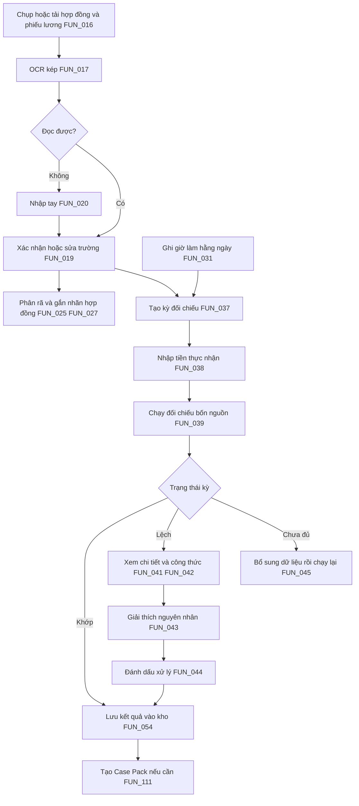

### WF_002 – Chia sẻ và xử lý Case Pack `[ĐÃ XÁC NHẬN]`

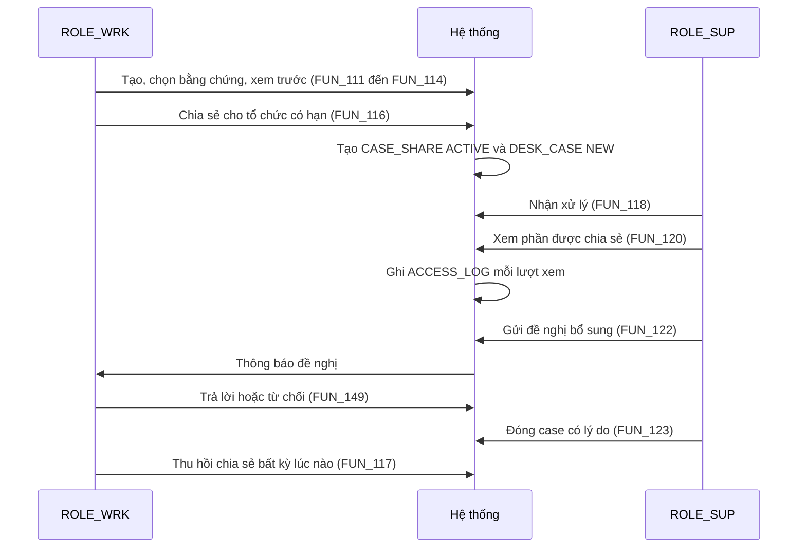

### WF_003 – Soạn, duyệt, phát hành Law Pack `[ĐÃ XÁC NHẬN]`

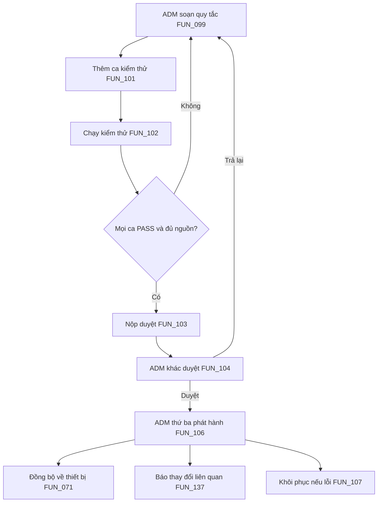

### WF_004 – Nhiệm vụ nhiều bước của agent có cổng phê duyệt `[ĐÃ XÁC NHẬN]`

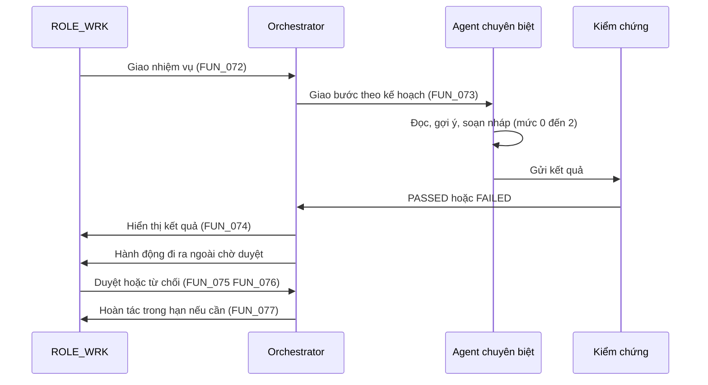

### WF_005 – Người thân xem qua liên kết chỉ-đọc `[ĐÃ XÁC NHẬN]`

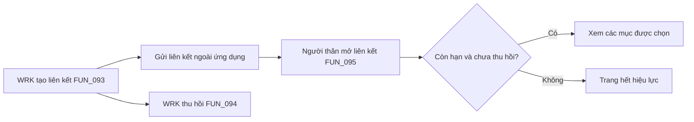

### WF_006 – Xử lý đề xuất từ agent Canh luật `[ĐÃ XÁC NHẬN]`

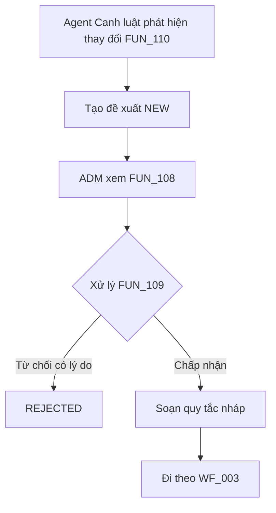

## 3. Sơ đồ trạng thái chính `[ĐỀ XUẤT]`

### PAY_PERIOD.period_status

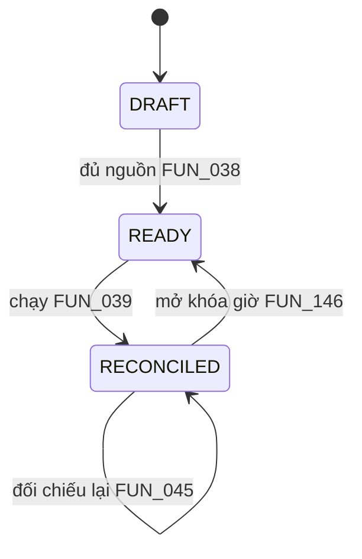

### LAW_RULE.rule_status

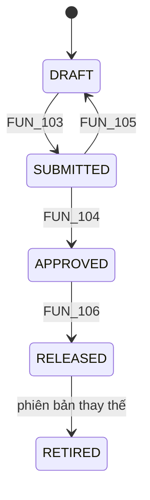

### CASE_SHARE.share_status và DESK_CASE.desk_case_status

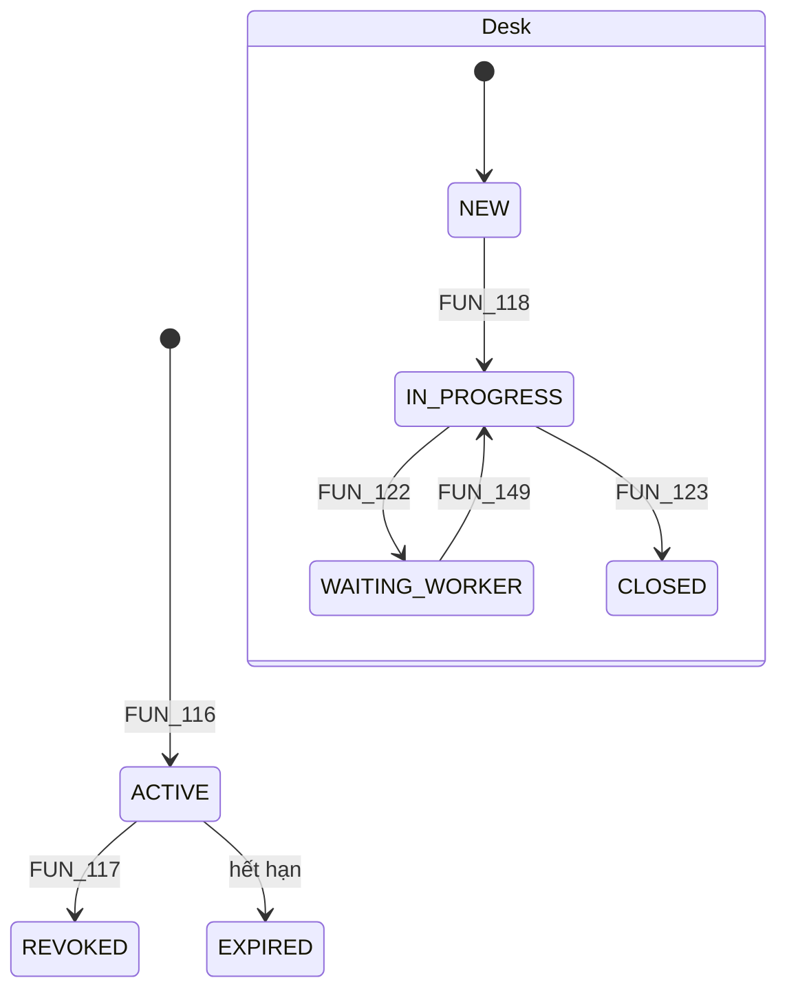

### AGENT_ACTION.approval_status

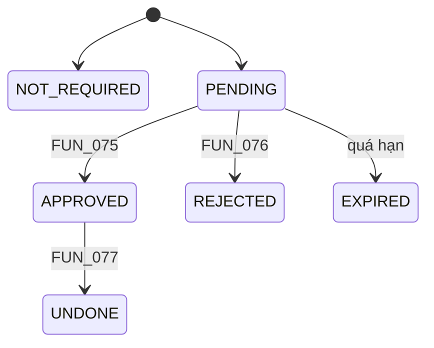

### DOCUMENT.ocr_status

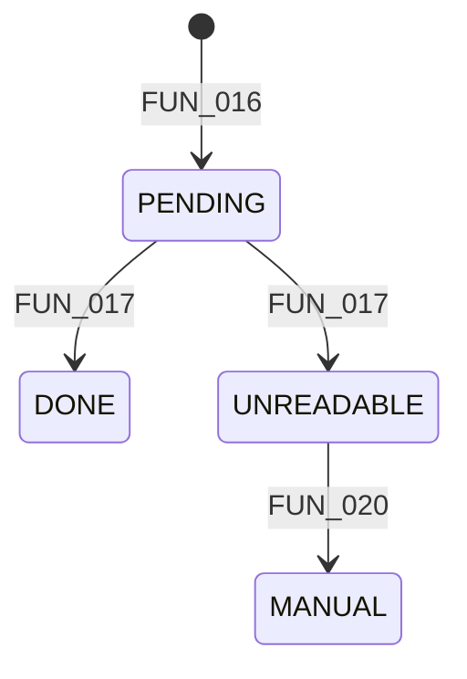

## 4. Phụ lục: trường chưa có chức năng nhập trực tiếp

Trong 555 trường, 117 trường không xuất hiện trong input hoặc output của chức năng nào; trong đó 116 trường do hệ thống sinh (khóa chính, khóa ngoại, thời điểm). Danh sách trường người dùng nhập mà chưa có chức năng gắn (cần rà soát): không có.
