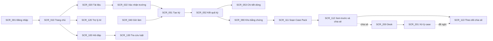

# WAYPOINT – MÔ TẢ GIAO DIỆN TỪNG MÀN HÌNH (WEB)

Phong cách **"Pastel Orbit – 軌道"**: nền vũ trụ pastel xanh dương phối hồng và vàng bơ, tờ giấy ứng dụng trắng bo tròn nổi giữa nền, bố cục bento lệch nhịp, hành tinh và vệ tinh chạy trên quỹ đạo, chút Nhật Bản (khoảng trắng, con dấu hanko, nhãn kanji nhỏ). Token, component, hiệu ứng và quy tắc code xem `UI_CODE_RULES.md`. Mã `FUN_` và `BR_` tham chiếu bộ đặc tả `WAYPOINT_BRD_SRS`. Mã `SCR_` là mã màn hình dùng làm `data-testid` và làm căn cứ kiểm thử.

Nhãn: `[ĐỀ XUẤT]` thiết kế đề xuất; số liệu trong khung minh họa là **dữ liệu mẫu**, không phải số thật.

## Mục lục

1. Cấu trúc menu (thiết kế lại)
2. Khung ứng dụng và thành phần dùng chung (SCR_000)
3. Xác thực (SCR_001–004)
4. Tổng quan: Trang chủ (SCR_010)
5. Hồ sơ & giờ làm: Tài liệu, Hợp đồng, Giờ làm (SCR_020–041)
6. Lương & chi phí: Đối chiếu, Mô phỏng, Chi phí, Nợ & gia đình (SCR_050–081)
7. Bằng chứng & hỗ trợ: Kho bằng chứng, Hỏi đáp, Hồ sơ nhờ hỗ trợ, Trợ lý AI (SCR_090–120)
8. Pháp luật: Tra cứu luật (SCR_130)
9. Tài khoản: Thông báo, Gói dịch vụ, Tài khoản (SCR_140–165)
10. Cổng Cán bộ hỗ trợ (SCR_200–202)
11. Cổng Quản trị viên (SCR_300–360)
12. Ma trận màn hình × chức năng
13. Luồng điều hướng chính

---

## 1. Cấu trúc menu (thiết kế lại) `[ĐỀ XUẤT]`

Giữ các nhóm hiện tại, bổ sung các mục còn thiếu so với đặc tả (Trợ lý AI, nhập nhanh, Passport) và thêm vùng "Lệnh nhanh".

| Nhóm | Mục menu | Icon gợi ý | Đường dẫn | Màn hình | Module |
|---|---|---|---|---|---|
| **TỔNG QUAN** | Trang chủ (Mission Control) | `layout-grid` | `/trang-chu` | SCR_010 | tổng hợp |
| **HỒ SƠ & GIỜ LÀM** | Tài liệu | `files` | `/tai-lieu` | SCR_020–022 | MOD_002 |
| | Hợp đồng | `file-text` | `/hop-dong` | SCR_030–031 | MOD_003 |
| | Giờ làm | `clock` | `/gio-lam` | SCR_040–041 | MOD_004 |
| **LƯƠNG & CHI PHÍ** | Đối chiếu lương | `shield-check` | `/doi-chieu-luong` | SCR_050–053 | MOD_005 |
| | Mô phỏng thu nhập | `line-chart` | `/mo-phong` | SCR_060–061 | MOD_006 |
| | Chi phí | `wallet` | `/chi-phi` | SCR_070 | MOD_010 |
| | Nợ & gia đình | `users` | `/no-gia-dinh` | SCR_080–081 | MOD_011 |
| **BẰNG CHỨNG & HỖ TRỢ** | Kho bằng chứng | `archive` | `/kho-bang-chung` | SCR_090–091 | MOD_007 |
| | Hỏi đáp quyền lợi | `message-circle-question` | `/hoi-dap` | SCR_100 | MOD_008 |
| | Hồ sơ nhờ hỗ trợ | `folder-check` | `/ho-so-ho-tro` | SCR_110–113 | MOD_013 |
| | **Trợ lý AI** (mới) | `sparkles` | `/tro-ly-ai` | SCR_120 | MOD_009 |
| **PHÁP LUẬT** | Tra cứu luật | `scale` | `/tra-cuu-luat` | SCR_130 | MOD_008, MOD_012 |
| **TÀI KHOẢN** | Thông báo | `bell` | `/thong-bao` | SCR_140 | MOD_015 |
| | Gói dịch vụ | `package` | `/goi-dich-vu` | SCR_150 | MOD_016 |
| | Tài khoản | `settings` | `/tai-khoan` | SCR_160–165 | MOD_001, MOD_017 |

Thêm vào khung:
- **Nút nổi "Ghi giờ nhanh" (FAB)** ở góc dưới phải mọi màn hình: mở SCR_041 (FUN_031/032).
- **Command Palette `⌘K`:** tìm tài liệu, kỳ lương, bằng chứng, quy tắc luật; chạy lệnh ("Ghi giờ hôm nay", "Chạy đối chiếu kỳ 11/2026", "Tạo Case Pack").
- **Cổng khác theo vai trò:** ROLE_SUP thấy menu riêng (Desk), ROLE_ADM thấy menu riêng (Quản trị); xem mục 10, 11.

---

### Quy ước phong cách áp dụng cho mọi màn hình `[ĐỀ XUẤT]`

| Nhóm menu | Nhãn kanji nhỏ cạnh tiêu đề | Màu chủ đạo của thẻ hero | Yếu tố quỹ đạo riêng |
|---|---|---|---|
| Tổng quan | `ホーム` | xanh nhạt → tím nhạt | Hệ quỹ đạo bốn nguồn |
| Hồ sơ & giờ làm | `書類` (Tài liệu), `契約` (Hợp đồng), `勤務` (Giờ làm) | xanh nhạt / tím nhạt / vàng bơ | Tài liệu là các "vệ tinh" xếp quanh ảnh chính; lịch giờ là vòng 30 ngày |
| Lương & chi phí | `照合` (Đối chiếu), `試算` (Mô phỏng), `費用` (Chi phí), `家族` (Gia đình) | hồng sakura / vàng bơ / bạc hà | Waterfall như các tầng hành tinh; mô phỏng có thanh trượt trên quỹ đạo |
| Bằng chứng & hỗ trợ | `証拠` (Bằng chứng), `相談` (Hỏi đáp), `支援` (Hỗ trợ), `助手` (Trợ lý) | tím nhạt / xanh nhạt / bạc hà / vàng bơ | Kho là "két" tròn có vòng toàn vẹn; Case Pack có tuyến đường tới tổ chức nhận |
| Pháp luật | `法令` | vàng bơ | Law Pack là một "chòm sao" các chủ đề nối bằng đường mảnh |
| Tài khoản | `設定` | xanh nhạt | Ít trang trí, ưu tiên rõ ràng |

Quy tắc chung:
- Mỗi trang có đúng 1 thẻ hero (lớn nhất, có hành tinh hoặc quỹ đạo), 2–4 thẻ vừa, các thẻ nhỏ còn lại; thẻ bên phải thường cao hơn để tạo nhịp lệch.
- Chữ Nhật chỉ là nhãn trang trí, luôn đi kèm chữ Việt (hoặc ngôn ngữ giao diện) ngay cạnh.
- `HankoStamp` chỉ gắn lên kết quả đã hoàn tất hoặc đã công bố, không dùng để trang trí vô nghĩa.
- Khu vực số liệu pháp lý (SCR_052, SCR_053, SCR_100, SCR_130) giảm trang trí: không linh vật, nền trắng hoặc pastel nhạt, chữ mực đậm.
- Cổng cán bộ và quản trị dùng cùng bộ component nhưng giảm 50% yếu tố trang trí.

---

## 2. Khung ứng dụng và thành phần dùng chung

### SCR_000 – App Shell `[ĐỀ XUẤT]`

Toàn bộ ứng dụng nằm trong **AppSheet**: tờ giấy trắng bo 40 px nổi trên nền vũ trụ pastel (gradient xanh dương → tím nhạt, có vài đường cong quỹ đạo mảnh), bóng đổ mềm phía dưới. Trên di động, tờ giấy tràn màn hình.

| Vùng | Nội dung |
|---|---|
| **Pill Rail** (thanh dọc bên trái, 72 px, mở rộng 264 px khi rê chuột) | Viên thuốc dài màu mực; icon của 16 mục menu xếp dọc theo 6 nhóm; mục đang chọn là **vòng tròn trắng** nhô ra khỏi thanh bằng "gờ nối" cong, icon xanh; khi mở rộng hiện nhãn nhóm nhỏ ("HỒ SƠ & GIỜ LÀM"), mũi tên đóng/mở và tên từng mục; cuối thanh: chuông thông báo có chấm hồng (FUN_134), nút Khóa nhanh (FUN_015), đăng xuất (FUN_003). Nút "Xóa nhanh" nằm trong menu Tài khoản (FUN_009) |
| **Header** | Logo hành tinh nhỏ "Lộ Trình"; lời chào lớn "Xin chào, {tên}" + dòng phụ "23 tháng 11 · 2 việc hôm nay"; bên phải: nút viên thuốc **Làm mới dữ liệu** và **Xuất**, nút tròn đen **＋** (menu nhanh: Ghi giờ, Tải tài liệu, Tạo kỳ, Hỏi luật), nút lưới ứng dụng, avatar có vòng quỹ đạo vàng |
| **Hàng tiêu đề trang** | Tiêu đề lớn 40–48 px kèm nhãn kanji nhỏ; chip lọc kiểu viên thuốc (đổi theo trang); ô tìm kiếm bo tròn `⌘K` (tìm tài liệu, kỳ lương, bằng chứng, quy tắc luật; chạy lệnh) và nút bộ lọc |
| **Chip Law Pack** (trong Header) | "VN → JP · v2026.10 · đã đồng bộ 02/11" (bạc hà = mới nhất, vàng = chưa đồng bộ; FUN_070/071) |
| **Ngôn ngữ, giao diện** | Chip VI/JA/EN (FUN_014); chuyển Sáng/Đêm vũ trụ |
| **Nội dung** | Lưới bento 12 cột, thẻ nhiều cỡ lệch nhịp; breadcrumb nhỏ phía trên tiêu đề |
| **Cột phải (Agent Dock)** | Thẻ cao có linh vật Mochi-Nauta, xem mục 2.1 |
| **Chân kết quả** | Dòng pháp lý cố định (UI_CODE_RULES mục 9) |
| **FAB** | Nút tròn "＋ Ghi giờ" ở góc dưới phải (SCR_041), chỉ hiện trên di động và tablet |

### 2.1 Agent Dock (dùng chung) `[ĐỀ XUẤT]`

Là **thẻ cao bên phải** (320 px, nền gradient vàng bơ → xanh nhạt, bo 28 px). Đầu thẻ: tiêu đề "Trợ lý của bạn" + nhãn `助手`; giữa thẻ là linh vật Mochi-Nauta bay trên một `OrbitTrack` nhỏ cùng các vệ tinh là 6 agent; trạng thái linh vật đổi theo nhiệm vụ (đang nghĩ, đang làm, cần bạn duyệt). Ở màn hẹp thu thành nút nổi tròn.

| Khối | Dữ liệu | Hành động |
|---|---|---|
| Nhiệm vụ đang chạy | `AGENT_TASK.task_status`, tiến độ từng bước, agent đảm nhận (biểu tượng 6 agent) | Xem kế hoạch (FUN_073), hủy |
| Chờ bạn duyệt (`ApprovalCard`) | Mô tả hành động, đếm ngược 48 giờ, mức tự chủ | Duyệt (FUN_075), Từ chối (FUN_076), Hoàn tác trong 24 giờ (FUN_077) |
| Gợi ý chủ động | "Thiếu giờ làm 3 ngày tuần này", "Luật tiền lương tối thiểu Tokyo vừa đổi" | Bấm để mở màn liên quan; tắt từng loại (FUN_078) |
| Lịch sử gần đây | 5 hành động gần nhất | "Xem tất cả" → SCR_120 |

### 2.2 Drawer chi tiết dòng đối chiếu (dùng ở nhiều màn)

Xem SCR_053.

### 2.3 Hộp thoại xác nhận nhạy cảm

Dùng cho xóa tài liệu, xóa tài khoản, mở khóa kỳ, chia sẻ Case Pack: tiêu đề, hậu quả liệt kê bằng gạch đầu dòng, ô nhập lại tên hành động hoặc mật khẩu khi cần, nút nguy hiểm màu đỏ-hồng.

---

## 3. Xác thực

### SCR_001 – Đăng nhập (FUN_002)

- **Bố cục:** chia đôi, lệch nhịp. Trái (58%): nền vũ trụ pastel với **hành trình quỹ đạo** – một đường cong mảnh nối Việt Nam với Nhật Bản, trên đường có 4 vệ tinh Hợp đồng → Giờ làm → Phiếu lương → Tiền nhận; hành tinh nhỏ hình mặt trời vàng ở góc, ba dòng giá trị ("Đối chiếu bốn nguồn", "Bằng chứng mang theo được", "Mọi con số có nguồn") dưới dạng `WashiTag` nghiêng nhẹ. Phải (42%): thẻ trắng bo 32 px, nổi lên và chồng nhẹ lên vùng trái.
- **Trường:** `login_identifier`, `password_plain` (nút hiện/ẩn); liên kết "Quên mật khẩu" (SCR_003), "Tạo tài khoản" (SCR_002); chọn ngôn ngữ.
- **Trạng thái:** sai thông tin hiện thông báo chung; khóa tạm hiện đồng hồ đếm ngược đến `locked_until` (BR_036).
- **Sau đăng nhập:** chuyển theo `role_code`: WRK → SCR_010, SUP → SCR_200, ADM → SCR_300.

### SCR_002 – Đăng ký (FUN_001)

- Stepper 3 bước: (1) Định danh + mật khẩu (thanh độ mạnh), (2) Hồ sơ nơi làm việc nhanh: nước làm việc, tỉnh, ngôn ngữ, (3) Quyền riêng tư: khóa PIN tùy chọn, các công tắc đồng ý mặc định tắt (BR_037).
- Cuối: hiện **khóa khôi phục một lần** trong khung sáng, nút "Đã lưu lại", cảnh báo không xem lại được `[CẦN XÁC NHẬN cơ chế khôi phục]`.

### SCR_003 – Khôi phục tài khoản (FUN_004)

Nhập định danh + khóa khôi phục + mật khẩu mới; sau khi xong hiện khóa khôi phục mới.

### SCR_004 – Mở khóa ứng dụng (FUN_015)

Nền vũ trụ pastel mờ, ở giữa là hành tinh lớn có 4–8 vệ tinh nhỏ; mỗi chữ số PIN nhập vào làm một vệ tinh sáng lên. Nút sinh trắc dạng viên thuốc; chế độ kín đáo hiển thị tên ứng dụng trung tính, không có logo.

---

## 4. Tổng quan

### SCR_010 – Trang chủ "Hệ quỹ đạo" (Mission Control) `[ĐỀ XUẤT]`

Mục tiêu: nhìn 10 giây biết (1) kỳ lương này có lệch không, (2) hôm nay cần làm gì, (3) hồ sơ bằng chứng và hỗ trợ đang ở đâu, (4) luật có đổi không.

Bố cục bento 3 cột lệch nhịp (trái 5 / giữa 4 / phải 3 cột trong lưới 12). Thẻ nhiều cỡ, một số thẻ nhô lên 16–24 px so với hàng; nền thẻ pastel theo ý nghĩa.

**Hàng tiêu đề:** "Trang chủ" `ホーム` + chip lọc kỳ (viên thuốc: `Kỳ 11/2026` · `Kỳ 10/2026` · `Cả năm`) + chip chế độ xem (`Tổng quan` · `Danh sách`) + ô tìm kiếm.

**Cột trái (5 cột):**

| Khối | Nội dung |
|---|---|
| **Hệ quỹ đạo bốn nguồn** (thẻ hero lớn, nền gradient xanh nhạt → tím nhạt, có `Seigaiha` mờ) | Ở giữa là **hành tinh Thực nhận** `¥214,600` (kỳ 11/2026, số lớn, vòng ring). Bốn **vệ tinh** chạy trên hai quỹ đạo nghiêng: Hợp đồng, Giờ làm, Phiếu lương, Tiền nhận. Viền vệ tinh theo trạng thái (bạc hà Khớp / hồng Lệch / vàng Chưa đủ); bấm vệ tinh → mở nguồn. Góc dưới trái: `Sticker` tròn nghiêng "27/30 dòng khớp". Góc trên phải: nút "Mở đối chiếu →" (FUN_040) và `PackBadge` |
| **Cảnh báo lệch** (thẻ hồng sakura, nhô lên, chồng nhẹ lên hero) | Biểu tượng cảnh báo trong vòng tròn vàng; "Kỳ 11/2026 – phát hiện lệch lương"; số chênh lớn `¥18,400` ở góc phải; 1 câu nguyên nhân (FUN_043, chip "Chế độ mẫu" khi cần); hai `SourceChip` (Điều luật, Phiếu lương tr.1); nút "Xem chi tiết đối chiếu →". Có `HankoStamp` nghiêng "要確認" (cần xem lại) cạnh nút |
| **Bốn thẻ nguồn nhỏ** (hàng 4 viên, nền pastel khác nhau: xanh, tím, vàng, bạc hà) | Hợp đồng · Giờ làm · Phiếu lương · Thực nhận: giá trị chính, trạng thái "đã có/thiếu", sparkline 6 kỳ |
| **Xu hướng thu nhập 6 kỳ** (thẻ trắng, đường mảnh) | Thực nhận (xanh dương đặc) so với Dự kiến theo hợp đồng (hồng nét đứt), vùng tô pastel, điểm dữ liệu chấm tròn viền trắng; nút "Xem dạng bảng", chuyển JPY/VND (FUN_046) |

**Cột giữa (4 cột):**

| Khối | Nội dung |
|---|---|
| **Kế hoạch hôm nay do AI soạn** (tiêu đề "Việc cần làm" + dải nhấn xanh đậm "Do trợ lý soạn") | Chip chọn nhanh: `Hôm nay` · `Tuần này` · `Quá hạn`. Hai thẻ nhóm: ① **Giờ làm & Tài liệu** (nền xanh nhạt): Ghi giờ hôm nay (Chưa làm), Xác nhận 3 trường phiếu lương, Tải phiếu lương 11/2026; ② **Hỗ trợ & Luật** (nền hồng nhạt): Trả lời đề nghị của cán bộ, Gia hạn chia sẻ sắp hết hạn, Xem thay đổi Law Pack. Mỗi thẻ có biểu tượng hành tinh nhỏ, số giờ/việc, nút `＋` |
| **Lịch tuần** (hàng ngày pastel) | 7 ô ngày với chấm màu loại ngày và giờ ghi; ô thiếu dữ liệu viền vàng; dưới là danh sách ngắn "Hôm nay": ghi giờ 08:00, hạn chia sẻ 12 ngày... (FUN_035) |
| **Heatmap giờ làm tháng** | 30 ô tròn, 5 mức pastel; tổng giờ thường/thêm/đêm; thanh tới mốc 60 giờ làm thêm |
| **Chi phí đi làm** | Tổng đã trả, thanh so trần phí, trạng thái Trong trần/Vượt trần (FUN_084/085) |

**Cột phải (3 cột):**

| Khối | Nội dung |
|---|---|
| **Trợ lý của bạn** (thẻ cao, gradient vàng bơ → xanh nhạt) | Mochi-Nauta ở giữa bay trên quỹ đạo nhỏ, đeo kính; 6 vệ tinh agent; dòng "Mochi đang đối chiếu kỳ 11"; ô giao việc có micro (FUN_072); **thẻ chờ duyệt** (`ApprovalCard`, đếm ngược 48 giờ, Duyệt/Từ chối, FUN_075/076); hai ô số liệu ở chân: "Việc đang chạy 2", "Chờ duyệt 1" |
| **Hồ sơ nhờ hỗ trợ** (nền bạc hà) | "Đang chia sẻ với Nghiệp đoàn ABC", hạn còn 12 ngày, số lượt xem; nút Thu hồi và Xem nhật ký (FUN_148) |
| **Law Pack VN → JP** (nền vàng bơ) | Phiên bản v2026.10 · cập nhật 02/11/2026, số quy tắc, thay đổi gần nhất; `HankoStamp` tròn "公布済" (đã công bố) |
| **Kho bằng chứng** | Số mục; **vòng toàn vẹn** "100% khớp mã băm" (FUN_060) |
| **Nợ & gia đình** | Vòng tiến độ trả nợ, ngày dự kiến trả hết, số người thân đang xem (FUN_090) |

**Hàng cuối (rộng 12 cột):** **Dòng sự kiện** dạng dòng thời gian ngang: các nút tròn trên một đường quỹ đạo, mỗi nút một sự kiện ("Đã đọc xong phiếu lương 11/2026", "Cán bộ A đã xem phần tóm tắt", "Agent đề xuất soạn thư"), icon, giờ, liên kết.

**Dòng chân:** "Mọi con số đối chiếu đều dựa trên Law Pack đã công bố – không phải kết luận pháp lý."

**Trạng thái người dùng mới:** thay hệ quỹ đạo bằng **hành trình 4 bước** là 4 hành tinh nối nhau (Tải hợp đồng → Xác nhận số liệu → Ghi giờ → Nhập tiền nhận); hành tinh hoàn thành sáng lên và có `HankoStamp`; biểu đồ hiển thị dữ liệu minh họa mờ có nhãn "Ví dụ". Mochi hướng dẫn bằng bong bóng thoại.

**Responsive:** < 1024 px xếp một cột theo thứ tự hệ quỹ đạo → cảnh báo lệch → việc cần làm → trợ lý → còn lại; hệ quỹ đạo giữ 4 vệ tinh nhưng thu nhỏ.

**FUN:** FUN_040, 035, 046, 060, 070, 072, 075, 076, 084, 085, 090, 134, 148.

---

## 5. Hồ sơ & giờ làm

### SCR_020 – Tài liệu (danh sách) – FUN_021

- **Hero nhỏ:** "Kho tài liệu" + 4 chip đếm: Hợp đồng, Phiếu lương, Sao kê, Khác; vòng "Đã đọc OCR 12/14".
- **Thanh công cụ:** tìm, lọc loại (`document_type`), lọc kỳ (`period_month`), chế độ lưới/danh sách, nút **＋ Tải tài liệu** (SCR_021).
- **Thẻ tài liệu:** ảnh thu nhỏ, loại, kỳ, ngày tải, `ocr_status` (Chờ/Xong/Không đọc được/Nhập tay), phiên bản `v2`, `HashStamp`; menu: Xem, Tải phiên bản mới (FUN_023), Xóa (FUN_024).
- **Cột phải:** "Thiếu gì?" – gợi ý tài liệu còn thiếu theo kỳ (ví dụ phiếu lương 11/2026 chưa có).

### SCR_021 – Tải tài liệu (modal lớn) – FUN_016

- Khu kéo thả viền nét đứt màu xanh dương, nền pastel, có hành tinh nhỏ và ngôi sao ✦ lấp lánh + nút Chụp ảnh (di động) + dán ảnh.
- Chọn `document_type`, `period_month` (bắt buộc với phiếu lương); hiện giới hạn "JPG, PNG, HEIC, PDF, tối đa {X} MB" (BR_040).
- Sau khi tải: thanh tiến độ 3 bước **Mã hóa → Quét an toàn → Đọc OCR kép** với `OrbitSweep` (tia quét quay quanh hành tinh); xong tự chuyển SCR_022.
- Lỗi: sai loại/quá lớn/phát hiện mã độc: thẻ lỗi nêu lý do.

### SCR_022 – Chi tiết tài liệu & xác nhận trường (split view) – FUN_018, 019, 020, 022

- **Trái (55%):** trình xem ảnh/PDF, thu phóng, chuyển trang; khi chọn một trường bên phải thì **khung sáng** đánh dấu vùng nguồn (`source_page`, `source_bbox`).
- **Phải (45%):** bảng trường trích xuất: nhãn `field_key`, giá trị đọc được, `ConfidenceBar`, huy hiệu "Hai lần đọc khớp/không khớp", ô **Giá trị xác nhận**, nút ✓ Xác nhận / ✎ Sửa / ✕ Bác bỏ. Trường độ tin cậy thấp có viền cam và nằm đầu danh sách.
- **Đầu trang:** chuỗi phiên bản (`v1 → v2`), `HashStamp`, nút "Thêm vào Kho bằng chứng" (FUN_054).
- **Chân:** thanh tiến độ "Đã xác nhận 9/12 trường bắt buộc" + nút **Tiếp tục tạo kỳ đối chiếu** (khóa nếu còn trường chưa xác nhận, BR_013).
- `ocr_status = UNREADABLE`: thay bảng bằng **biểu mẫu nhập tay** theo loại tài liệu (FUN_020) và biểu ngữ "Không đọc được ảnh – nhập tay hoặc tải ảnh rõ hơn".

### SCR_030 – Hợp đồng (danh sách) – FUN_021 (lọc CONTRACT), FUN_029

- Thẻ lớn mỗi hợp đồng: chủ sử dụng, thời hạn, hiệu lực, **ba chip nhãn luật** (số điều khoản Phù hợp / Nên hỏi lại / Chưa có quy tắc), số điểm cần hỏi còn mở.
- Cột phải: "Điểm cần hỏi nổi bật" (3 câu gần nhất) và nút "Soạn thư hỏi lại" (giao cho agent, FUN_072).

### SCR_031 – Hợp đồng song ngữ (chi tiết) – FUN_026, 028, 029, 030

- **Tab:** Song ngữ | Điểm cần hỏi | Tóm tắt.
- **Song ngữ:** hai cột Gốc (Nhật) và Dịch (Việt); mỗi điều khoản có số, chủ đề (chip), `LawLabel`, nút "Vì sao?" mở `law_note` + `SourceChip` điều luật + `PackBadge`. Cuộn đồng bộ hai cột; thanh mục lục điều khoản bên trái nhỏ.
- **Điểm cần hỏi:** danh sách câu hỏi gợi ý, trạng thái Mở/Đã hỏi/Đã làm rõ/Bỏ qua (FUN_030), ô ghi chú, nút "Đưa vào Kho bằng chứng".
- **Tóm tắt:** bảng thông số hợp đồng đã xác nhận (lương giờ, giờ chuẩn, phụ trội, khấu trừ) và radar "Mức độ rõ ràng".
- Điều khoản chưa có quy tắc: nhãn xám + câu "Chưa có quy tắc trong Law Pack – không kết luận."

### SCR_040 – Giờ làm (lịch tháng) – FUN_035

- **Hero KPI (4 thẻ):** Tổng giờ tháng, Giờ làm thêm (kèm thanh tới mốc 60 giờ), Giờ đêm, Giờ ngày nghỉ luật định.
- **Lịch tháng:** mỗi ô ngày hiện giờ (ví dụ `8.5h`), chấm màu theo loại ngày, nền heatmap; ô thiếu dữ liệu viền cam "chưa ghi"; ô đã khóa có icon ổ khóa (BR_015). Bấm ô → drawer SCR_041.
- **Cột phải:** biểu đồ cột xếp chồng 4 tuần; "Ngày chưa ghi" (danh sách bấm nhanh); "Kỳ liên quan": nút "Tạo kỳ đối chiếu" khi tháng đủ dữ liệu.
- **Thanh công cụ:** chuyển tháng, nút Nhập từ bảng ca (FUN_036), Mở khóa kỳ (FUN_146, hộp thoại xác nhận).

### SCR_041 – Ghi giờ (drawer/FAB) – FUN_031, 032, 033, 034

- Tab: **Nhanh | Giọng nói | Thủ công**.
- **Nhanh:** ngày (mặc định hôm nay), nút chọn ca có sẵn (Sáng/Chiều/Đêm) hoặc giờ vào – giờ ra bằng bánh xe, phút nghỉ, loại ngày (Thường/Nghỉ luật định/Nghỉ theo lịch), ghi chú.
- **Giọng nói:** nút micro lớn có sóng âm; hiện văn bản nhận dạng và các giá trị đã điền để xác nhận trước khi lưu (không lưu âm thanh).
- **Hiện ngay:** "Tổng 8h30 · đêm 1h30" tính từ máy chủ (BR_052); cảnh báo ca chồng nhau.
- Sửa/xóa mục có sẵn; mục khóa hiện "Mở khóa kỳ" thay cho nút Sửa.

---

## 6. Lương & chi phí

### SCR_050 – Đối chiếu lương (danh sách kỳ) – FUN_046, 040

- **Hero:** "Trung tâm đối chiếu" với gauge tổng hợp các kỳ và dòng "3 kỳ Khớp · 1 kỳ Lệch · 1 kỳ Chưa đủ".
- **Dòng thời gian kỳ** (ngang, kiểu hành tinh/nút nối): mỗi nút là một tháng, màu theo `result_summary`, số tiền chênh trên nút lệch.
- **Bảng kỳ:** kỳ, thực nhận, chênh lệch, `StatusPill`, phiên bản Law Pack, ngày chạy; hành động Mở, Đối chiếu lại (FUN_045).
- Nút **＋ Tạo kỳ mới** (SCR_051). Biểu đồ xu hướng chênh lệch 6 kỳ.

### SCR_051 – Tạo kỳ đối chiếu (wizard 4 bước) – FUN_037, 038, 039

1. **Chọn kỳ và tài liệu:** tháng, hợp đồng, phiếu lương (chọn từ SCR_020).
2. **Kiểm tra dữ liệu:** bảng "Bốn nguồn" với dấu ✓/⚠: hợp đồng đã xác nhận trường? phiếu lương? giờ làm đủ ngày? Mục thiếu có nút "Bổ sung ngay".
3. **Tiền thực nhận:** `MoneyInput`, ngày nhận, nhãn tài khoản (không nhập số tài khoản).
4. **Chạy:** nút lớn **Chạy đối chiếu**; trong lúc chạy hiện 5 bước (chọn quy tắc → tính từng khoản → so bốn nguồn → gán nhãn → tổng hợp) với `OrbitSweep`. Hoàn tất chuyển SCR_052.

### SCR_052 – Kết quả kỳ – FUN_040, 041, 042, 043, 044, 045

- **Hero kết quả:** `StatusPill` lớn, số tiền chênh khổng lồ, câu giải thích (FUN_043) kèm chip "Chế độ mẫu" khi `explanation_mode=TEMPLATE`; `PackBadge`; nút Đối chiếu lại, Thêm vào Kho bằng chứng, Tạo Case Pack (FUN_111).
- **Waterfall (thác):** Lương cơ bản → Phụ trội làm thêm → Phụ trội đêm → Ngày nghỉ → Phụ cấp → Khấu trừ (thuế, bảo hiểm, nhà ở) → Thực nhận; bước lệch tô hồng.
- **Bảng bốn nguồn:** hàng là khoản mục (`item_code`), cột Hợp đồng | Giờ làm | Phiếu lương | Thực nhận | Tối thiểu theo luật | Chênh lệch | `StatusPill` | `LawLabel`. Hàng Lệch xếp trước. Bấm hàng → drawer SCR_053.
- **Cột phải:** "Dữ liệu còn thiếu" (cho dòng Chưa đủ), "Tình trạng xử lý" (Không/Đang hỏi/Đã làm rõ/Bỏ qua, FUN_044), nút "Soạn thư hỏi chủ sử dụng" (giao agent).

### SCR_053 – Drawer chi tiết dòng đối chiếu – FUN_041, 042

- Đầu: khoản mục, `StatusPill`, `LawLabel`.
- **Công thức đã thay số** (khung mono): ví dụ `1.300 × 70 × 1,25 = …`; từng nguồn có `SourceChip` (hợp đồng tr.2, phiếu lương tr.1, mục giờ ngày X).
- **Căn cứ luật:** tên quy tắc, điều khoản, nguồn chính thức, ngày hiệu lực, `PackBadge`.
- **Giải thích** bằng ngôn ngữ dễ hiểu; **Ghi chú xử lý**; nút "Đưa vào Kho bằng chứng".
- Dòng chân: "Số liệu do bộ tính cố định tạo ra, không do AI tính."

### SCR_060 – Mô phỏng thu nhập (Salary Twin) – FUN_047, 048, 049, 050, 051

- **Trái – Bảng điều khiển** (thanh trượt + ô nhập): lương giờ, giờ chuẩn/tháng, giờ làm thêm, giờ đêm, giờ ngày nghỉ, phụ cấp, khấu trừ cố định, tỉnh. Nút Lưu kịch bản, danh sách kịch bản đã lưu.
- **Giữa – Kết quả sống:** số lớn "Thu nhập tối thiểu theo luật" so với "Theo hợp đồng", chênh lệch; waterfall; cảnh báo nếu lương giờ thấp hơn mức tối thiểu tỉnh (kèm `SourceChip`).
- **Phải – Độ nhạy:** đường "thêm 10 giờ làm thêm thì +bao nhiêu", điểm gãy ở mốc 60 giờ (phụ trội cao hơn).
- Kết quả cập nhật từ máy chủ khi thả thanh trượt (debounce 400 ms) kèm skeleton số; không tính ở giao diện.

### SCR_061 – So sánh lời đề nghị việc làm – FUN_052, 053

- Biểu mẫu nhập tối đa 3 lời đề nghị (thẻ cạnh nhau).
- Bảng so sánh: thu nhập ước tính/tháng, nhà ở, khấu trừ, thời hạn, cảnh báo lương tối thiểu; radar 3 phương án; hàng "Khác biệt lớn nhất" tô sáng.
- Nút "Thêm đề nghị", "Lưu nhóm so sánh".

### SCR_070 – Chi phí đi làm (Cost Ledger) – FUN_081–086

- **Hero:** tổng đã trả (VND/JPY), vòng "Đã đưa chứng từ 6/8", trạng thái so trần: **Trong trần / Vượt trần / Bị cấm / Chưa có quy tắc** (BR_030; ghi chú `[CẦN XÁC NHẬN văn bản hợp nhất]`).
- **Thanh trần phí:** thanh ngang "Phí dịch vụ đã trả so với mức trần theo hợp đồng", đánh dấu mốc 1 tháng và 3 tháng lương.
- **Bảng khoản chi:** loại (môi giới, dịch vụ, đào tạo, visa, đi lại, đặt cọc), số tiền, trả cho, ngày, chứng từ (liên kết tài liệu), `cap_check_status`. Thêm/sửa/xóa bằng drawer.
- **Cột phải:** biểu đồ donut theo loại; "Khoản cần chú ý" (môi giới thu từ người lao động).

### SCR_080 – Nợ & gia đình – FUN_087–096

Tab: **Khoản nợ | Kế hoạch trả | Người thân**.

- **Khoản nợ:** thẻ mỗi khoản (bên cho vay, gốc, lãi, dư nợ, hạn trả hằng tháng), vòng tiến độ, nút Ghi lần trả (FUN_089); biểu đồ cột "đã trả theo tháng".
- **Kế hoạch trả:** ô nhập thu nhập/chi tiêu/số trả mỗi tháng, kết quả "Ngày dự kiến trả hết", bảng lịch gốc–lãi–còn lại, đường dư nợ giảm dần; nút Lưu kế hoạch (FUN_091/092).
- **Người thân:** nút **Tạo liên kết** (FUN_093): chọn tên gợi nhớ, mục được xem (tiến độ nợ, tóm tắt tháng), hạn; hiện liên kết **một lần** kèm mã QR và nút sao chép; bảng liên kết (trạng thái, số lượt xem, lần xem cuối) + nút **Thu hồi** (FUN_094/096).

### SCR_081 – Trang người thân (công khai, chỉ đọc) – FUN_095

- Không đăng nhập; nền sáng dịu, thân thiện; vòng tiến độ nợ, ngày dự kiến trả hết, tóm tắt tháng nếu được chia sẻ; dòng "Liên kết hết hạn ngày …".
- Hết hạn/thu hồi: màn "Liên kết không còn hiệu lực". Không có nút ghi hay liên kết ra ngoài.

---

## 7. Bằng chứng & hỗ trợ

### SCR_090 – Kho bằng chứng – FUN_054–063

- **Hero:** "Két an toàn" với vòng toàn vẹn "100% mã băm khớp" và số mục; nút **＋ Thêm bằng chứng**, **Xuất PDF** (FUN_062), **Xác minh tất cả** (FUN_060).
- **Tab hiển thị:** Lưới | Dòng thời gian (FUN_058) | **Passport** (SCR_091).
- **Lọc/Tìm:** từ khóa, thẻ, loại (Tài liệu, Kết quả đối chiếu, Khoảng giờ, Ghi chú, Thư), khoảng ngày (FUN_056).
- **`EvidenceCard`:** tiêu đề, loại, ngày sự việc, thẻ, `HashStamp` + trạng thái toàn vẹn (✓/⚠), số lần sửa; menu: Gắn thẻ/ghi chú (FUN_057), Lịch sử sửa (FUN_059), Thêm vào Case Pack, Xóa (FUN_061; chặn nếu đang chia sẻ).
- **Dòng thời gian:** trục dọc nhóm theo tháng, nút nổi bật cho sự kiện then chốt.

### SCR_091 – Passport làm việc (tab của SCR_090) – FUN_063

Thẻ hộ chiếu số: chủ sử dụng, tỉnh, ngày bắt đầu, hợp đồng, số kỳ đã đối chiếu và kết quả, huy hiệu "Mang theo được" (xuất được ra PDF). Dùng chung phong cách thẻ kính có `HUD` góc.

### SCR_100 – Hỏi đáp quyền lợi (Legal Compass) – FUN_064–067

- **Bố cục chat:** giữa là luồng hội thoại; phải là **Bảng trích dẫn** của câu trả lời đang chọn.
- **Ô nhập:** gợi ý nhanh (chip): "Làm thêm giờ được trả bao nhiêu?", "Công ty giữ hộ hộ chiếu có được không?", "Lương tối thiểu tỉnh tôi?" (FUN_069).
- **Câu trả lời:** nội dung ngắn, mỗi ý có chỉ số `[1]` liên kết tới trích dẫn; chip `CITED` (đã dẫn nguồn). Nếu không có quy tắc: khung xám "Chưa có quy tắc phù hợp trong Law Pack – mình không trả lời để tránh sai" (`REFUSED`, BR_028/029).
- **Bảng trích dẫn:** tên quy tắc, điều khoản, nguồn chính thức (liên kết), ngày hiệu lực, `PackBadge`, nhãn "Chuyên gia đã ký/Nội bộ" (`review_label`) (FUN_065).
- **Phản hồi:** 👍 Hữu ích / ⚠ Sai (kèm ghi chú) (FUN_066). Cột trái thu gọn: lịch sử hỏi đáp (FUN_067).

### SCR_110 – Hồ sơ nhờ hỗ trợ (danh sách Case Pack) – FUN_111, 148

- Thẻ Case Pack: tiêu đề, loại vấn đề, kỳ liên quan, trạng thái (Nháp/Sẵn sàng/Đã chia sẻ/Đóng), số bằng chứng; với bản đã chia sẻ: tổ chức nhận, **đếm ngược hạn**, số lượt xem.
- Nút **＋ Tạo hồ sơ** (SCR_111); mục "Danh bạ hỗ trợ" bên phải: tổ chức công khai theo ngôn ngữ/quốc gia, nút "Chia sẻ cho tổ chức này".
- Biểu ngữ "Đề nghị bổ sung thông tin" khi có `INFO_REQUEST` mở (SCR_113).

### SCR_111 – Soạn Case Pack (wizard) – FUN_111–113

1. **Thông tin:** tiêu đề, loại vấn đề, từ kỳ – đến kỳ, tóm tắt tiếng Việt.
2. **Chọn bằng chứng:** hai cột (Kho bên trái, Case Pack bên phải), kéo thả; công tắc "Kèm bản gốc" từng mục.
3. **Bản dịch & thư:** tóm tắt tiếng Nhật do hệ thống soạn (người dùng sửa), soạn thư song ngữ (FUN_113); chip nguồn dịch (Mẫu/LLM).
4. **Xem trước** → SCR_112.

### SCR_112 – Xem trước & chia sẻ – FUN_114, 115, 116, 117

- **Trái:** bản xem trước **đúng** nội dung sẽ chia sẻ, từng phần có công tắc bật/tắt (`ShareScopePicker`).
- **Phải:** chọn tổ chức nhận (chỉ tổ chức nhận Case Pack), **hạn chia sẻ** (bắt buộc, tối đa `[CẦN XÁC NHẬN 30 ngày]`), `ConsentToggle` "Đồng ý chia sẻ Case Pack" (BR_037); danh sách "Tổ chức sẽ thấy: …" và "Sẽ KHÔNG thấy: …".
- Nút **Xuất PDF** (tự gửi ngoài ứng dụng) và **Chia sẻ** (xác nhận hai bước). Sau khi chia sẻ: thẻ "Đang chia sẻ" với **Thu hồi ngay**.

### SCR_113 – Theo dõi chia sẻ & đề nghị bổ sung – FUN_148, 149

- **Nhật ký truy cập:** `AccessLogRow` (cán bộ, hành động Xem/Ghi chú/Đề nghị/Đóng/Nhận, phần đã xem, giờ) (BR_020).
- **Đề nghị bổ sung thông tin:** nội dung đề nghị, mục yêu cầu, đếm ngược hạn trả lời; ô trả lời, nút Trả lời / Từ chối (FUN_149). Cảnh báo "Bạn toàn quyền quyết định; chỉ chia sẻ khi muốn".
- Trạng thái case tổng quan: Mới → Đang xử lý → Chờ bạn → Đóng (stepper).

### SCR_120 – Trợ lý AI (Rights Agent) – FUN_072–080

- **Hero:** linh vật Mochi-Nauta bay trên quỹ đạo (`OrbitTrack`) + ô giao việc lớn "Bạn muốn trợ lý làm gì?" + 6 chip agent (Hợp đồng, Chi phí đi làm, Đối chiếu lương, Bằng chứng & Hồ sơ, Canh luật, Hỗ trợ/Nợ/Gia đình).
- **Tab:** Nhiệm vụ | Chờ duyệt | Lịch sử | Thiết lập.
- **Nhiệm vụ:** danh sách; mở nhiệm vụ → **sơ đồ kế hoạch** (các bước và agent, trạng thái từng bước), kết quả chỉ hiện khi Kiểm chứng đạt (chip PASSED; nếu FAILED hiện cảnh báo) (FUN_073/074).
- **Chờ duyệt:** `ApprovalCard` (nội dung đầy đủ, mức tự chủ 0–2, đếm ngược 48 giờ, nút Duyệt/Từ chối); mục "Có thể hoàn tác" 24 giờ (FUN_075–077).
- **Lịch sử:** bảng hành động (agent, loại, mô tả, duyệt, thời điểm) (FUN_080).
- **Thiết lập (FUN_078):** công tắc giám sát chủ động (luật liên quan, hạn quan trọng, dữ liệu thiếu), giới hạn hành động/ngày; khung nhắc "Trợ lý không bao giờ tự gửi, tự chia sẻ hay thanh toán".

---

## 8. Pháp luật

### SCR_130 – Tra cứu luật – FUN_068, 069, 070

- **Hero:** thẻ Law Pack: hành lang VN → JP, phiên bản, ngày phát hành, số quy tắc, ghi chú thay đổi gần nhất, nút "Đồng bộ ngay", trạng thái ngoại tuyến.
- **Tab theo hành lang:** Nhật Bản (nước làm việc) | Việt Nam (nước gửi).
- **Lưới chủ đề (thẻ icon):** Làm thêm, Làm đêm, Ngày nghỉ luật định, Trên 60 giờ, Lương tối thiểu, Khấu trừ, Giữ hộ hộ chiếu, Trần phí, Hợp đồng rõ ràng, Phạt vi phạm, Tiết kiệm bắt buộc...
- **Bảng "Lương giờ tối thiểu theo tỉnh":** tìm tỉnh, hiện mức và ngày hiệu lực; tỉnh của người dùng được tô sáng.
- **Danh sách quy tắc theo chủ đề:** tên, điều khoản, hiệu lực, nhãn rà soát (Chuyên gia đã ký/Nội bộ), nguồn; bấm mở khung chi tiết có `SourceChip`.
- **Dòng thời gian thay đổi luật:** các phiên bản đã phát hành (người dùng chỉ thấy bản công bố).
- Chủ đề chưa có: thẻ xám "Chưa có quy tắc".

---

## 9. Tài khoản

### SCR_140 – Thông báo – FUN_134, 135, 133

- **Trái:** danh sách theo loại (Nhắc ghi giờ, Ngày lương, Chia sẻ sắp hết hạn, Luật thay đổi, Đề nghị của cán bộ, Đóng case, Cần duyệt agent, Hệ thống), chưa đọc đậm, đánh dấu đã đọc.
- **Phải:** thiết lập nhắc việc: bật/tắt từng loại, giờ nhắc ghi giờ, số ngày sau ngày lương, **giờ yên lặng** (từ – đến); xem trước nội dung thông báo khi bật kín đáo.

### SCR_150 – Gói dịch vụ – FUN_138, 139

- So sánh **Free** và **Pro** (thẻ cạnh nhau; thông số `[CẦN XÁC NHẬN]`), nhấn mạnh "Lõi miễn phí vẫn dùng đầy đủ".
- **Mức sử dụng tháng:** vòng "Lượt LLM 37/100", "Trang OCR", ngày làm mới; khi hết hạn mức hiện chip "Chuyển sang chế độ mẫu" (BR_039).
- Nâng/hạ/hủy gói: hộp thoại nêu thời điểm có hiệu lực (BR_044); lịch sử đăng ký.

### SCR_160 – Tài khoản (tab cha)

| Tab | Màn hình | Nội dung | FUN |
|---|---|---|---|
| Hồ sơ | SCR_161 | Nước, tỉnh, chủ sử dụng, ngành, ngày bắt đầu, ngày trả lương, tiền tệ; ngôn ngữ; cảnh báo "đổi tỉnh sẽ cần đối chiếu lại" | FUN_006, 014 |
| Riêng tư & bảo mật | SCR_162 | Khóa PIN/sinh trắc, tự khóa sau, **chế độ kín đáo** (chọn tên/biểu tượng trung tính, xem trước), ẩn nội dung thông báo, **Xóa nhanh**, đổi mật khẩu | FUN_005, 007, 008, 009 |
| Đồng ý | SCR_163 | 4 công tắc mặc định tắt: Chia sẻ Case Pack, LLM bên ngoài, Đóng góp ẩn danh, Đồng bộ; mỗi công tắc có "dữ liệu nào rời thiết bị" và nút xem trước nội dung đóng góp (FUN_140) | FUN_010, 140 |
| Thiết bị & phiên | SCR_164 | Danh sách phiên (thiết bị, nền tảng, hoạt động gần nhất), thu hồi từng phiên | FUN_011 |
| Dữ liệu | SCR_165 | Đồng bộ mã hóa (bật, sao lưu, khôi phục; cảnh báo không thể khôi phục nếu quên cụm mật khẩu), Xuất dữ liệu cá nhân, Xóa tài khoản (hộp thoại nguy hiểm, liệt kê hậu quả) | FUN_143, 144, 145, 013, 012 |

---

## 10. Cổng Cán bộ hỗ trợ (ROLE_SUP)

Menu riêng: **Desk** (SCR_200), **Thông báo**, **Tài khoản**. Cùng phong cách Pastel Orbit nhưng chủ đề xanh bạc hà + xanh dương, hành tinh hóa "trạm tiếp nhận", để phân biệt vai trò. Cố định biểu ngữ "Bạn chỉ thấy phần người lao động đã chia sẻ".

### SCR_200 – Desk: danh sách case – FUN_118, 119

- **Hero KPI:** Case mới, Đang xử lý, Chờ người lao động, Sắp hết hạn chia sẻ.
- **Bảng case** (chỉ tổ chức của cán bộ): mã case, loại vấn đề, ngày nhận, trạng thái, người phụ trách, **hạn chia sẻ**; lọc theo trạng thái; nút **Nhận xử lý** (FUN_118). Case hết hạn hoặc bị thu hồi biến mất khỏi danh sách.
- Cột phải: "Việc cần làm" (đề nghị chưa trả lời, case sắp hết hạn).

### SCR_201 – Xem & xử lý case – FUN_120–123

- **Trái (60%):** nội dung chia sẻ: tóm tắt song ngữ (chuyển Việt/Nhật), danh sách bằng chứng đã chia sẻ (đúng `shared_sections`), kết quả đối chiếu và nguồn.
- **Phải:** Ghi chú nội bộ (người lao động không thấy) (FUN_121), **Gửi đề nghị bổ sung** (FUN_122), Đổi trạng thái/**Đóng case** (lý do bắt buộc) (FUN_123), dòng thời gian thao tác, đếm ngược hạn chia sẻ.
- Mỗi lần mở: ghi nhật ký truy cập (BR_020); thông báo "Lượt xem của bạn được ghi lại".
- Chia sẻ bị thu hồi khi đang xem: khóa màn hình ngay, hiện "Người lao động đã thu hồi chia sẻ".

### SCR_202 – Kích hoạt tài khoản cán bộ – FUN_147

Trang từ liên kết lời mời: tên tổ chức, email được mời, đặt mật khẩu, kích hoạt; hết hạn → hướng dẫn xin mời lại.

---

## 11. Cổng Quản trị viên (ROLE_ADM)

Menu riêng: **Tổng quan**, **Law Pack**, **Tổ chức & cán bộ**, **Quản trị viên**, **Nhật ký kiểm toán**, **Cấu hình**, **Giám sát**. Chủ đề tím lavender + mực đậm, gọn hơn (ít trang trí, không linh vật); thao tác có rủi ro dùng nền vàng bơ và nút hồng. Biểu ngữ cố định: "Quản trị không có quyền xem nội dung người dùng" (BR_005).

### SCR_300 – Tổng quan quản trị – FUN_124, 132

- KPI vận hành: số quy tắc đã phát hành, đề xuất Canh luật chờ xử lý, quy tắc chờ duyệt, tổ chức hoạt động, cán bộ.
- Biểu đồ **k-ẩn danh** (chỉ hiện khi đủ ngưỡng, BR_043): tỷ lệ kỳ lương lệch theo tháng, theo khoản mục.
- Tình trạng nhà cung cấp (OCR, LLM, thông báo, thanh toán) và hàng đợi; số case Desk theo trạng thái (không nội dung).
- "Việc của tôi": quy tắc chờ tôi duyệt (không phải do tôi soạn), phiên bản chờ phát hành.

### SCR_310 – Law Pack: hành lang & nguồn luật – FUN_097, 098

- Hai tab: **Hành lang** (mã XX-YY, trạng thái, phiên bản đang dùng) và **Nguồn luật** (tên, đơn vị công bố, quốc gia, hạng A/B/C, URL, ngày truy cập, trạng thái).
- Biểu mẫu tạo/sửa trong drawer; nguồn đang được quy tắc dùng không cho tắt.

### SCR_311 – Law Pack: danh sách quy tắc – FUN_099, 100

- Bảng quy tắc: `rule_code`, chủ đề, hành lang, hiệu lực, `rule_status` (Nháp/Đã nộp/Đã duyệt/Đã phát hành/Hết dùng), người soạn, người duyệt, nhãn rà soát.
- Lọc theo trạng thái; **bảng Kanban** thay thế (4 cột theo trạng thái) để thấy tiến độ.
- Nút **＋ Soạn quy tắc** → SCR_312.

### SCR_312 – Soạn quy tắc – FUN_099, 100, 101, 102, 103

- Biểu mẫu chia 3 khối: **Định danh** (mã, hành lang, chủ đề, tiêu đề), **Căn cứ** (nguồn, điều khoản gốc, ngày hiệu lực/hết hiệu lực, nhãn rà soát), **Tham số** (trình soạn JSON theo lược đồ theo `rule_type`, xem trước công thức).
- Dải bên phải: **Ca kiểm thử** (thêm ca, dữ liệu vào, kết quả mong đợi), nút **Chạy kiểm thử** hiện PASS/FAIL từng ca và đầu ra thực tế.
- Nút **Nộp duyệt** chỉ bật khi đủ nguồn, điều khoản, hiệu lực và mọi ca PASS (BR_025); khung "Điều kiện còn thiếu" liệt kê rõ.

### SCR_313 – Law Pack: duyệt quy tắc – FUN_104, 105

- So sánh bản đề xuất với bản đang áp dụng (diff hai cột), ca kiểm thử và kết quả, nguồn.
- Nút **Duyệt** / **Trả lại** (ý kiến bắt buộc). Nếu người đăng nhập là người soạn: nút bị khóa kèm lý do (BR_001).

### SCR_314 – Law Pack: phát hành & phiên bản – FUN_106, 107, 150

- **Tạo phiên bản mới:** danh sách quy tắc `APPROVED` sẽ được đóng gói, ghi chú thay đổi (5–2000 ký tự), kiểm tra BR_001 (ba Quản trị viên khác nhau) hiển thị dạng danh sách ✓/✕.
- **Lịch sử phiên bản** (dòng thời gian): nhãn, thời điểm, người phát hành, ghi chú, trạng thái (Đã phát hành/Đã khôi phục), checksum; nút **Khôi phục** (hộp thoại nguy hiểm, giải thích sẽ tạo phiên bản mới).
- Sau phát hành: hiện số thiết bị cần đồng bộ và số người dùng sẽ nhận thông báo liên quan (BR_042).

### SCR_315 – Đề xuất từ Canh luật – FUN_108, 109, 110

- Danh sách đề xuất: nguồn, thời điểm phát hiện, tóm tắt thay đổi, liên kết bằng chứng, quy tắc bị ảnh hưởng.
- Hành động: **Chấp nhận** (mở quy tắc nháp liên quan) hoặc **Từ chối** (lý do bắt buộc). Nhấn mạnh "Đề xuất không tự áp dụng" (BR_027).

### SCR_320 – Tổ chức & cán bộ hỗ trợ – FUN_125, 126

- Bảng tổ chức (tên, loại, quốc gia, ngôn ngữ, nhận Case Pack, trạng thái); drawer sửa; công tắc "Hiện trong danh bạ", "Nhận Case Pack", nút Tạm ngưng (ghi chú: chia sẻ đang có giữ nguyên đến hết hạn).
- Tab Cán bộ của tổ chức: danh sách, trạng thái Đã mời/Hoạt động/Khóa, nút **Mời cán bộ** (email, tên), gửi lại lời mời.

### SCR_330 – Quản trị viên – FUN_127

- Danh sách Quản trị viên (tên, trạng thái, lần đăng nhập gần nhất), nút Mời/Khóa/Thu hồi quyền.
- Thanh cảnh báo cố định: "Hệ thống cần tối thiểu 2 Quản trị viên hoạt động" (BR_002); nút thao tác trên chính mình bị khóa (BR_003).

### SCR_340 – Nhật ký kiểm toán – FUN_128

- Bộ lọc: loại tác nhân, mã hành động, đối tượng, kết quả, khoảng thời gian; bảng chỉ đọc; mở dòng xem `detail_json` (không chứa nội dung người dùng); xuất CSV. Không có nút sửa/xóa (BR_004).

### SCR_350 – Cấu hình – FUN_129, 130, 131

- Tab **Nhà cung cấp** (OCR/LLM/Thông báo/Thanh toán): thứ tự ưu tiên, bật/tắt, dự phòng, tham chiếu điểm kết nối (không hiện khóa gốc); cảnh báo khi tắt nhà cung cấp tự host cuối cùng.
- Tab **Tham số hệ thống:** nhóm (LLM, từ chối, OCR, chia sẻ, bảo mật), giá trị, kiểu, mô tả; xác thực kiểu và khoảng ở giao diện.
- Tab **Gói dịch vụ:** Free/Pro, giá, hạn mức LLM.
- Tab **Lưu trữ:** số ngày lưu theo nhóm dữ liệu, cách xử lý khi hết hạn; nhật ký kiểm toán không thể rút ngắn dưới mức tối thiểu.

### SCR_360 – Giám sát vận hành – FUN_132

Bảng điều khiển kỹ thuật: tình trạng dịch vụ, độ trễ, hàng đợi OCR/LLM, lỗi gần nhất theo loại; không có nội dung người dùng.

---

## 12. Ma trận màn hình × chức năng

| Màn hình | FUN chính |
|---|---|
| SCR_001–004 | FUN_001, 002, 004, 015 |
| SCR_010 | FUN_040, 035, 060, 070, 072, 075, 134, 148 |
| SCR_020–022 | FUN_016–024 |
| SCR_030–031 | FUN_026, 028, 029, 030 |
| SCR_040–041 | FUN_031–036, 146 |
| SCR_050–053 | FUN_037–046 |
| SCR_060–061 | FUN_047–053 |
| SCR_070 | FUN_081–086 |
| SCR_080–081 | FUN_087–096 |
| SCR_090–091 | FUN_054–063 |
| SCR_100 | FUN_064–067 |
| SCR_110–113 | FUN_111–117, 148, 149 |
| SCR_120 | FUN_072–080 |
| SCR_130 | FUN_068–071 |
| SCR_140 | FUN_133–135 |
| SCR_150 | FUN_138, 139 |
| SCR_160–165 | FUN_003, 005–014, 140, 143–145 |
| SCR_200–202 | FUN_118–123, 147 |
| SCR_300–360 | FUN_097–110, 124–132, 150 |

Chức năng nền do hệ thống thực hiện, không có màn hình riêng: FUN_017 (OCR), FUN_025, 027 (phân rã, nhãn luật hợp đồng), FUN_043 (giải thích), FUN_071 (đồng bộ Law Pack), FUN_079 (đề xuất chủ động), FUN_085 (kiểm tra trần), FUN_110 (Canh luật), FUN_136, 137 (gửi thông báo), FUN_141, 142 (đóng góp ẩn danh). Kết quả của chúng hiển thị ở các màn hình liên quan.

---

## 13. Luồng điều hướng chính

Quy ước điều hướng:
- Từ bất kỳ kết quả nào (dòng đối chiếu, điều khoản hợp đồng, câu trả lời hỏi đáp) đều có đường tới **nguồn** (tài liệu, điều luật) và **Kho bằng chứng**.
- Thao tác thay đổi dữ liệu quan trọng luôn đưa người dùng quay về màn hình xuất phát kèm toast "Hoàn tác".
- Phím tắt: `⌘K` tìm kiếm, `G` rồi `H` về Trang chủ, `N` ghi giờ nhanh, `?` bảng phím tắt.
